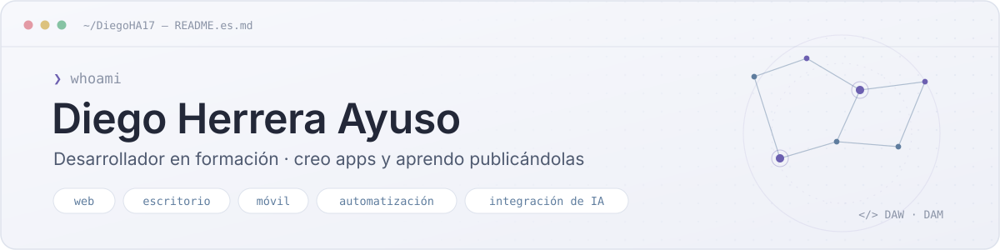

<!-- README del perfil · DiegoHA17 · versión en español -->

  <a href="https://github.com/DiegoHA17">
    <picture>
      <source media="(prefers-color-scheme: dark)" srcset="assets/lang-es-dark.svg">
      
    </picture>
  </a>

<picture>
  <source media="(prefers-color-scheme: dark)" srcset="assets/banner-dark-es.svg">
  <source media="(prefers-color-scheme: light)" srcset="assets/banner-light-es.svg">
  
</picture>

  <a href="https://diegoha17.github.io/PortFolio_DHA/">Portfolio</a> ·
  <a href="https://www.linkedin.com/in/diegx">LinkedIn</a> ·
  <a href="https://github.com/DiegoHA17?tab=repositories">Repositorios</a>

## Sobre mí

Soy Diego, desarrollador. Terminé el CFGS de **Desarrollo de Aplicaciones Web (DAW)** en 2026 y ahora curso **Desarrollo de Aplicaciones Multiplataforma (DAM)** para pasar del navegador al escritorio y al móvil.

Hice cuatro meses de prácticas como desarrollador full stack en **Adcore**, trabajando sobre aplicaciones empresariales en producción: nuevas funcionalidades, corrección de errores en código de otros programadores, un módulo multimoneda con AG Grid, envíos de correo con Mailrelay y despliegues. Ahí PHP, JavaScript y MySQL se convirtieron en mis herramientas de cada día.

Fuera de clase hago mis propias aplicaciones. Casi todas nacen de un problema que tengo yo, y últimamente mezclan tecnologías web con aplicaciones de escritorio, automatización e IA local.

- **Ahora:** cursando DAM, mejorando Lunar Finance y aprendiendo Kotlin para Android.
- **Busco:** mi primer puesto como desarrollador en Madrid, Ávila o en remoto.

## Tecnologías

  <b>En el día a día</b> · en el trabajo y en la mayoría de proyectos 
  <picture>
    <source media="(prefers-color-scheme: dark)" srcset="https://skillicons.dev/icons?i=php%2Cjs%2Cmysql%2Chtml%2Ccss%2Cjquery%2Cgit&amp;theme=dark">
    
  </picture>

  <b>He hecho proyectos con</b> · al menos una app terminada 
  <picture>
    <source media="(prefers-color-scheme: dark)" srcset="https://skillicons.dev/icons?i=ts%2Creact%2Crust%2Ctauri%2Celectron%2Cpython%2Cfastapi%2Ctailwind%2Csqlite%2Cdocker&amp;theme=dark">
    
  </picture>

  <b>Aprendiendo ahora</b> · asignaturas de DAM 
  <picture>
    <source media="(prefers-color-scheme: dark)" srcset="https://skillicons.dev/icons?i=kotlin%2Candroidstudio&amp;theme=dark">
    
  </picture>

También he trabajado con: AG Grid · Bootstrap · Mailrelay / SMTP · API de Notion · Ollama · APIs de Gemini y Replicate · GitHub Actions y Pages · Railway · Figma

## Proyectos destacados

### 🌙 [Lunar Finance](https://github.com/DiegoHA17/lunar-finance)

Aplicación de escritorio que convierte una base de datos de gastos de Notion en un panel de finanzas personales: reglas que clasifican los movimientos, pagos periódicos sin duplicados, informes PDF e IA local opcional con Ollama. No hay servidor: tus datos se quedan en tu Notion. Es open source y tiene instaladores para Windows y Linux.

`Tauri` `Rust` `React` `TypeScript` · [Repositorio](https://github.com/DiegoHA17/lunar-finance) · [Descargas](https://github.com/DiegoHA17/lunar-finance/releases)

### 🧾 [Your Small Desk](https://github.com/DiegoHA17/Your-Small-Desk)

Aplicación de escritorio sin conexión para autónomos y pequeños negocios: clientes, presupuestos con o sin IVA, PDFs con tu marca, control de estados y resúmenes trimestrales. Una aplicación PHP empaquetada con Electron sobre una base de datos SQLite local.

`PHP` `Electron` `SQLite` `mPDF` · [Repositorio](https://github.com/DiegoHA17/Your-Small-Desk)

### 🕹️ [Portfolio interactivo](https://diegoha17.github.io/PortFolio_DHA/)

Mi portfolio convertido en un pequeño juego de plataformas pixel art: caminas, saltas e interactúas con objetos para abrir cada sección. Sistema de niveles reutilizable, colisiones, fondos animados, sonido, controles táctiles y versión en español e inglés.

`JavaScript` `Módulos ES` `i18next` `GitHub Pages` · [Demo](https://diegoha17.github.io/PortFolio_DHA/) · [Repositorio](https://github.com/DiegoHA17/PortFolio_DHA)

### 👕 DressIA

Mi proyecto de fin de ciclo de DAW: un armario digital que sugiere qué ponerte según el clima y tu estilo. Una web en PHP y un microservicio en Python que quita el fondo de las fotos. Las recomendaciones siguen reglas propias; la IA solo ayuda.

`PHP` `MySQL` `FastAPI` `Docker` · Proyecto de fin de ciclo, código no público

## Estadísticas de GitHub

  <picture>
    <source media="(prefers-color-scheme: dark)" srcset="https://ghstats.dev/api/card?username=DiegoHA17&amp;bg=161b26&amp;text=a9b4c8&amp;title_color=b8aef0&amp;icon_color=8fa8c8&amp;border_color=2a3142&amp;border_radius=10&amp;hide=stars%2Cfollowers%2Cavg%2Ctrend%2Cissues%2Cgrade%2Chours%2Cweek%2Crepos&amp;custom_title=Actividad%20en%20GitHub">
    
  </picture>
  <picture>
    <source media="(prefers-color-scheme: dark)" srcset="https://ghstats.dev/api/langs?username=DiegoHA17&amp;bg=161b26&amp;text=a9b4c8&amp;title_color=b8aef0&amp;icon_color=8fa8c8&amp;border_color=2a3142&amp;border_radius=10&amp;layout=donut&amp;max_langs=6&amp;custom_title=Lenguajes%20m%C3%A1s%20usados">
    
  </picture>

## Contacto

La mejor forma de contactar conmigo es [LinkedIn](https://www.linkedin.com/in/diegx). También puedes ver mi trabajo en el [portfolio interactivo](https://diegoha17.github.io/PortFolio_DHA/).

<code>❯ git commit -m "siempre construyendo lo siguiente"</code>

