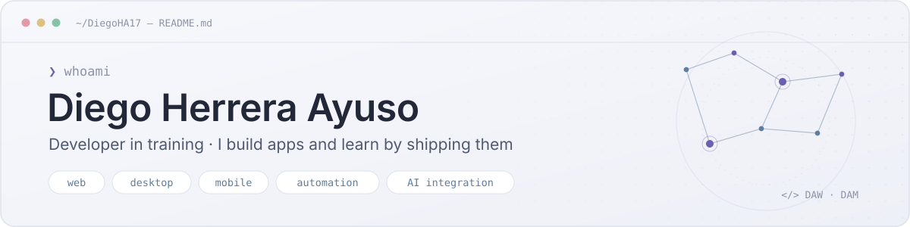

<!-- Profile README · DiegoHA17 -->

  <a href="https://github.com/DiegoHA17/DiegoHA17/blob/main/README.es.md">
    <picture>
      <source media="(prefers-color-scheme: dark)" srcset="assets/lang-en-dark.svg">
      
    </picture>
  </a>

<picture>
  <source media="(prefers-color-scheme: dark)" srcset="assets/banner-dark.svg">
  <source media="(prefers-color-scheme: light)" srcset="assets/banner-light.svg">
  
</picture>

  <a href="https://diegoha17.github.io/PortFolio_DHA/">Portfolio</a> ·
  <a href="https://www.linkedin.com/in/diegx">LinkedIn</a> ·
  <a href="https://github.com/DiegoHA17?tab=repositories">Repositories</a>

## About me

I'm Diego, a developer from Spain. I finished my Higher Technician degree in **Web Application Development (DAW)** in 2026 and I'm now studying **Multiplatform Application Development (DAM)** to move from the browser to desktop and mobile.

Outside of class I build my own apps. Most of them start with a problem I have myself, and lately they mix web technologies with desktop packaging, automation and local AI.

Right now I'm improving Lunar Finance and learning Kotlin for Android.

## Tech stack

  <b>Day to day</b> · the tools I use in most of my projects 
  <picture>
    <source media="(prefers-color-scheme: dark)" srcset="https://skillicons.dev/icons?i=php%2Cjs%2Cmysql%2Chtml%2Ccss%2Cjquery%2Cgit&amp;theme=dark">
    
  </picture>

  <b>Built projects with</b> · shipped at least one app 
  <picture>
    <source media="(prefers-color-scheme: dark)" srcset="https://skillicons.dev/icons?i=ts%2Creact%2Crust%2Ctauri%2Celectron%2Cpython%2Cfastapi%2Ctailwind%2Csqlite%2Cdocker&amp;theme=dark">
    
  </picture>

  <b>Learning now</b> · DAM coursework 
  <picture>
    <source media="(prefers-color-scheme: dark)" srcset="https://skillicons.dev/icons?i=kotlin%2Candroidstudio&amp;theme=dark">
    
  </picture>

Also worked with: Bootstrap · Notion API · Ollama · Gemini and Replicate APIs · GitHub Actions and Pages · Railway · Figma

## Featured projects

### 🌙 [Lunar Finance](https://github.com/DiegoHA17/lunar-finance)

Desktop app that turns a Notion expense database into a personal finance dashboard: rules that categorise movements, recurring payments without duplicates, PDF reports and optional local AI with Ollama. There's no server, so your data stays in your Notion. Open source, with installers for Windows and Linux.

`Tauri` `Rust` `React` `TypeScript` · [Repository](https://github.com/DiegoHA17/lunar-finance) · [Releases](https://github.com/DiegoHA17/lunar-finance/releases)

### 🧾 [Your Small Desk](https://github.com/DiegoHA17/Your-Small-Desk)

Offline desktop app for freelancers and small businesses: clients, quotes with or without VAT, branded PDFs, status tracking and quarterly summaries. A PHP app packaged with Electron on top of a local SQLite database.

`PHP` `Electron` `SQLite` `mPDF` · [Repository](https://github.com/DiegoHA17/Your-Small-Desk)

### 🕹️ [Interactive portfolio](https://diegoha17.github.io/PortFolio_DHA/)

My portfolio as a small pixel-art platformer: walk, jump and interact with objects to open each section. Reusable level system, collisions, animated backgrounds, sound, touch controls and English/Spanish.

`JavaScript` `ES modules` `i18next` `GitHub Pages` · [Live demo](https://diegoha17.github.io/PortFolio_DHA/) · [Repository](https://github.com/DiegoHA17/PortFolio_DHA)

### 👕 DressIA

My DAW final project: a digital wardrobe that suggests outfits from the weather and your style. A PHP web app plus a Python microservice that removes photo backgrounds. Recommendations follow my own rules; AI only assists.

`PHP` `MySQL` `FastAPI` `Docker` · Final degree project, code not public

## GitHub stats

  <picture>
    <source media="(prefers-color-scheme: dark)" srcset="https://ghstats.dev/api/card?username=DiegoHA17&amp;bg=161b26&amp;text=a9b4c8&amp;title_color=b8aef0&amp;icon_color=8fa8c8&amp;border_color=2a3142&amp;border_radius=10&amp;hide=stars%2Cfollowers%2Cavg%2Ctrend%2Cissues%2Cgrade%2Chours%2Cweek%2Crepos&amp;custom_title=GitHub%20activity">
    
  </picture>
  <picture>
    <source media="(prefers-color-scheme: dark)" srcset="https://ghstats.dev/api/langs?username=DiegoHA17&amp;bg=161b26&amp;text=a9b4c8&amp;title_color=b8aef0&amp;icon_color=8fa8c8&amp;border_color=2a3142&amp;border_radius=10&amp;layout=donut&amp;max_langs=6&amp;custom_title=Most%20used%20languages">
    
  </picture>

## Contact

The best way to reach me is [LinkedIn](https://www.linkedin.com/in/diegx). You can also explore my work in the [interactive portfolio](https://diegoha17.github.io/PortFolio_DHA/).

<code>❯ git commit -m "always building the next thing"</code>

